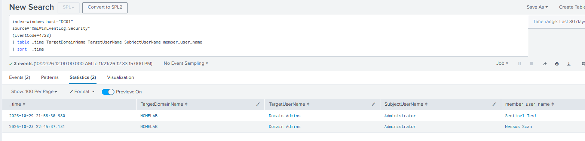
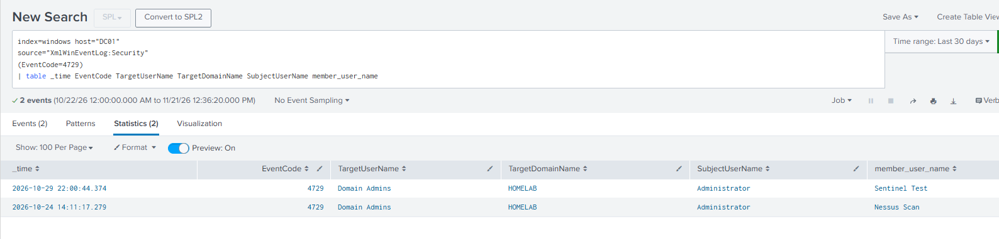
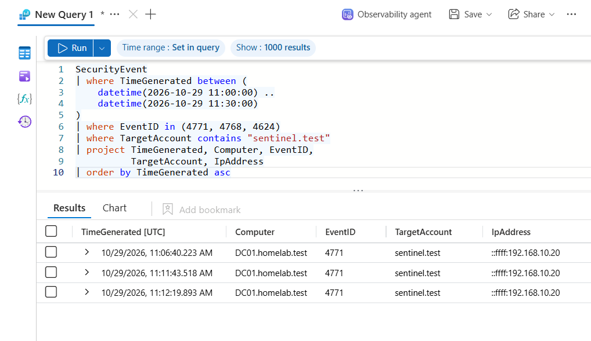
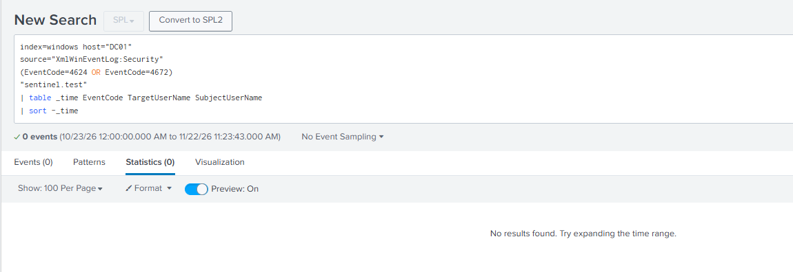
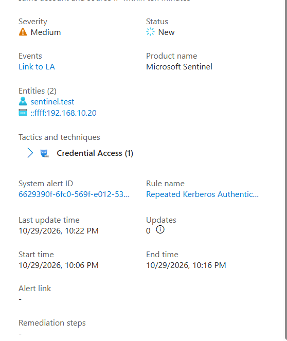

# SOC Case 001 — Investigation of Temporary Domain Admin Membership

**Type:** Controlled home-lab security investigation  
**Environment:** Windows Active Directory (`homelab.test`)  
**Analyst tools:** Splunk Enterprise (SPL), Microsoft Sentinel / Log Analytics (KQL)  
**Primary host:** `DC01`  
**Related workstation:** `WIN11-01` (`192.168.10.20`)  
**Date of observed events:** 29 October 2026 (Melbourne daylight saving time, AEDT)  
**Lab outcome:** Authorised testing / benign positive  
**Production-style triage priority:** High, pending change authorisation and activity review

> **Scope and integrity:** The account names, IP addresses, screenshots and detection findings below come from a controlled home lab. This case documents how a SOC analyst would investigate a similar alert in production. An observed lack of matching events in one search is **not** proof that an action never occurred.

## Executive summary

A Windows Security event showed a test account being **added to the Domain Admins group** on DC01. The same account was **removed approximately 2 minutes 13 seconds later**. Microsoft Sentinel subsequently recorded three **Kerberos pre-authentication failures** for `sentinel.test` originating from WIN11-01. A Splunk search of DC01's Event IDs 4624 and 4672 over the displayed 30-day window returned **no matching events containing `sentinel.test`**.

Because the changes and authentication attempts were generated during authorised lab testing, the **lab disposition is benign positive**. In a production environment without that context, these observations would warrant investigation rather than immediate closure: temporary privileged membership can still create risk, and no matching logon in DC01 does not rule out other activity.

## Investigation objective

Determine **who** added an account to Domain Admins, **when** it was added and removed, whether subsequent **authentication or privileged logon activity** was visible, and whether the evidence justified a malicious-activity conclusion.

## Environment and data sources

| Source | Evidence used | Why it matters |
|---|---|---|
| DC01 Windows Security logs → Splunk `index=windows` | Event IDs **4728** and **4729** | Records additions to/removals from security-enabled global groups |
| DC01 Windows Security logs → Splunk | Event IDs **4624** and **4672** | Searches for successful logons and special privileges on new logon sessions |
| DC01 Windows Security logs → Microsoft Sentinel `SecurityEvent` | Event ID **4771** | Records Kerberos pre-authentication failure |
| Microsoft Sentinel incident | Repeated Kerberos Authentication Failures | Shows the correlated detection context and affected account/source |

Splunk input in these screenshots: `XmlWinEventLog:Security`. Sentinel used a Log Analytics workspace receiving DC01 security events through Azure Monitor Agent and a Data Collection Rule.

## Key findings and evidence

### 1 — Account added to Domain Admins

**29 Oct 2026, 21:58:30.980 AEDT** — Windows Security **4728** on DC01 shows the member **Sentinel Test** added to **Domain Admins** by **Administrator**. The same search also returned a separate historical addition for the Nessus Scan account; that event is not part of this primary case.

**SPL:** [`queries/01-group-additions.spl`](queries/01-group-additions.spl)

### 2 — Account removed from Domain Admins

**29 Oct 2026, 22:00:44.374 AEDT** — Windows Security **4729** on DC01 shows **Sentinel Test** removed from **Domain Admins** by **Administrator**. The interval between this removal and the recorded addition is approximately **133.4 seconds (2 min 13 sec)**.

**SPL:** [`queries/02-group-removals.spl`](queries/02-group-removals.spl)

### 3 — Later Kerberos authentication failures

A Log Analytics query of DC01's `SecurityEvent` table found **three 4771 events** for `sentinel.test`, source `::ffff:192.168.10.20` (IPv4-mapped IPv6 notation for the WIN11-01 address). These are the **three events shown in this focused screenshot**, not necessarily all failed authentications for the account across the full environment or historical period.

**KQL:** [`queries/04-kerberos-focused-hunt.kql`](queries/04-kerberos-focused-hunt.kql)

### 4 — Successful/privileged logon search on DC01

A Splunk search for **4624 OR 4672** and the literal `sentinel.test` returned **zero matching events** in the displayed 30-day search window on **DC01**. This is a negative search result with a limited scope, not a definitive statement that the account never logged on to DC01 or WIN11-01.

**SPL:** [`queries/03-authentication-review.spl`](queries/03-authentication-review.spl)

### 5 — Sentinel incident context

Microsoft Sentinel generated a **Medium-severity** incident for **Repeated Kerberos Authentication Failures**, with entities `sentinel.test` and `::ffff:192.168.10.20`. The incident showed an alert window from approximately **22:06 to 22:16 AEDT**. Incident creation time and alert window are different from the event timestamps above.

## Reconstructed timeline

| Time, 29 Oct 2026 (AEDT) | Event ID | Observed activity | Evidence |
|---|---:|---|---|
| 21:58:30.980 | 4728 | `Sentinel Test` added to `Domain Admins`; actor: `Administrator` | Splunk screenshot 01 |
| 22:00:44.374 | 4729 | `Sentinel Test` removed from `Domain Admins`; actor: `Administrator` | Splunk screenshot 02 |
| 22:06:40.223 | 4771 | Kerberos pre-authentication failure for `sentinel.test` from WIN11-01 | Log Analytics screenshot 03 |
| 22:11:43.518 | 4771 | Additional Kerberos pre-authentication failure | Log Analytics screenshot 03 |
| 22:12:19.893 | 4771 | Additional Kerberos pre-authentication failure | Log Analytics screenshot 03 |

The Log Analytics screenshot displays UTC; these times have been converted to Melbourne daylight saving time (UTC+11). The evidence set does **not** show an SID-level join proving that the friendly name `Sentinel Test` in group-change logs is the same account as `sentinel.test` in the Kerberos logs; that association is based on the known lab scenario and should be verified explicitly in production.

## Analyst assessment

**Observed:** A privileged group membership change and reversal on DC01, followed by Kerberos pre-authentication failures from an internal workstation. No matching DC01 successful/special-privilege logon was returned in the scoped search.

**Not established by this evidence:** Whether the change had formal approval; who operated the `Administrator` session; whether the account used its elevated access; whether it authenticated to another host; whether other Kerberos failures or successful authentications occurred beyond the shown window; or whether follow-on persistence was created.

**Production-style decision:** Treat as a suspicious privileged group modification pending verification of change authorisation and additional host/account telemetry. Do **not** call this a confirmed brute-force attack solely because 4771 events exist.

**Known lab disposition:** Benign positive — actions were part of authorised home-lab validation, not a production attack.

## Investigation limitations

- **DC01-only success search:** The 4624/4672 screenshot searched DC01; it is not a comprehensive search of WIN11-01 or the entire domain.
- **Specific username matching:** The query used a literal string search; alternate representations, log types or account fields might not match.
- **Visible subset of 4771 events:** Three 4771 records are visible in the focused Log Analytics query; wider historical investigation may yield more.
- **No activity proof:** The group-membership interval does not show what actions, if any, were taken using elevated rights.
- **No direct SID correlation:** The screenshots do not demonstrate SID equality between `Sentinel Test` and `sentinel.test`.

## Recommended production follow-up

1. Validate change-ticket approval, the purpose of the privileged membership and the human operator behind the `Administrator` activity.
2. Retrieve account creation/modification records (including **4720** where available) and correlate the account SID and group-member SID.
3. Search all relevant endpoints, domain controllers and authentication sources for logons, session privileges, process activity and network connections within and after the elevated-access interval.
4. Review other privileged-group changes, newly created accounts, scheduled tasks, services and other potential persistence indicators.
5. Preserve source events, record query time ranges and document the disposition and detection-tuning decision.

## Detection and engineering lessons

- A **4728** event proves a global-group addition, not that privileged access was exercised.
- **4729** records removal, but a short time in Domain Admins still warrants contextual review.
- **4771** records Kerberos pre-authentication failure; repeated failures are not proof of brute force without wider context.
- **4624/4672** can provide useful authentication and privilege evidence, but absence from a scoped search requires qualification.
- Correlating Windows and Sentinel data requires care with **time zones, usernames and SIDs**.

## Files

- [`incident-report.md`](incident-report.md) — concise analyst handoff
- [`queries/`](queries/) — reproducible SPL/KQL queries
- [`evidence/`](evidence/) — five original screenshots from the investigation

**Publication safety:** These files contain only lab identifiers to the best of the available review. Verify all screenshots and remove any sensitive fields before uploading a public repository.
